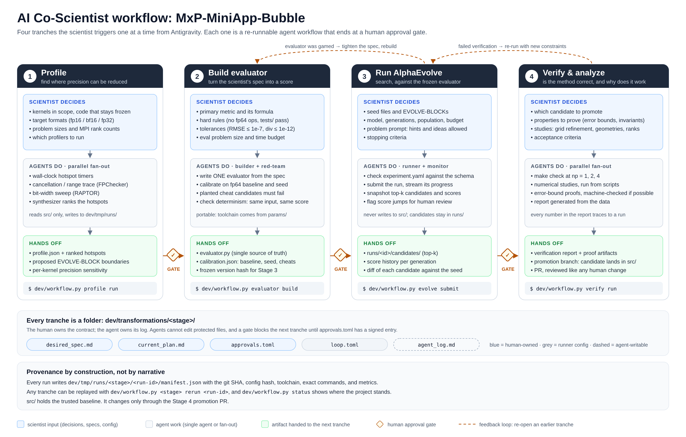

# AI Co-Scientist workflow

[`schematic.svg`](schematic.svg) is the editable source. [`schematic.png`](schematic.png) is a 2x export of it.

## Why this shape

The `origin/dev` branch shows what Antigravity and AlphaEvolve can do together. In one swarm pass it
profiled the kernels (FPChecker, RAPTOR), wrote evaluators, ran AlphaEvolve, and produced proofs and
studies. The results are impressive, but a scientist can't easily *steer*, *audit*, or *re-run* any one
of those steps. The schematic splits the same work into four tranches. Each one is started by the
scientist, driven by their decisions, and ends at a gate the scientist signs off on:

| # | Tranche | The scientist provides | The agents produce | Gate question |
|---|---------|------------------------|--------------------|---------------|
| 1 | Profile | kernels in scope, target formats, sizes, profilers | ranked hotspots, precision sensitivity, proposed EVOLVE-BLOCKs | "Are these the right kernels to evolve?" |
| 2 | Build evaluator | metric, hard rules, tolerances, eval budget | one evaluator, calibrated on baseline/seed, red-teamed with cheats | "Does this score mean what I think it means?" |
| 3 | Run AlphaEvolve | experiment config, prompt, budget, stop criteria | top-k candidates + score history in `runs/`, never in `src/` | "Which candidate is worth verifying?" |
| 4 | Verify & analyze | candidate, properties to prove, studies, acceptance | `make check` at np=1,2,4, studies, proofs, a report built from data | "Do I merge this into `src/`?" |

Each tranche would live in `dev/transformations/<stage>/`, using the same contract files as the
CodeScribe transformations: `desired_spec.md`, `current_plan.md`, and `approvals.toml` are owned by the
human; `agent_log.md` is the only file the agent may write there. `dev/workflow.py <stage> ...` is the
single entry point, so Antigravity (or a person) triggers a tranche with one command and can replay any
past run from its manifest.

## Where the `origin/dev` work fits

Most of what was built has a natural home. What's missing is the separation between steps and the
human checkpoints between them.

| In `origin/dev` | Tranche | What would change |
|-----------------|---------|-------------------|
| `dev/evaluators/profile_hotspots.cpp`, `dev/reports/fpchecker_*`, `raptor_*`, `hotspot_profile_128x128.json` | 1 Profile | Write to `dev/tmp/runs/profile/<id>/` with a manifest. The scientist picks the hotspots and block boundaries at the gate. |
| `assets/alphaevolve-{advect,redistance,init,driver}/evaluator.py`, `dev/evaluators/eval_*.py`, `assets/alphaevolve-demo/experiment/evaluator.py` | 2 Evaluator | The `dev/evaluators/eval_*.py` files are byte-identical copies of the per-hotspot evaluators. Keep one evaluator with per-kernel modes. Move toolchain paths (e.g. `/opt/rh/gcc-toolset-15`, also hardcoded in the `Makefile`) into `params/`. Add calibration and cheat tests. |
| `assets/alphaevolve-*/experiment.yaml`, `dev/tools/alpha_evolve_skills/` | 3 Evolve | The scientist owns the config. Candidates stay in `runs/`. The skills become the runner/monitor agents for this tranche. |
| Evolved kernels committed straight into `src/{advect,redistance,init,driver,grid}.cpp` (~1,700 lines added) | 3 → 4 | `src/` stays the fp64 baseline that the evaluator compares against. A candidate reaches `src/` only through the Stage 4 promotion PR. |
| `dev/proofs/*.md`, `dev/studies/*` | 4 Verify | The studies are already script-driven, which is good. Proofs should be machine-checked where possible (e.g. error bounds), or labeled as informal arguments. |
| `dev/reports/*.md`, top-level `*_REPORT.md` / `*_PLAYBOOK.md` | 4 Verify | Generate reports from run data so the numbers can't drift (the score appears as both 15.6374 and 15.6384). |
| `dev/provenance/` (debate transcripts, persona ledgers, a 2-step runbook) | all | Replace with `approvals.toml` + `agent_log.md` + run manifests: provenance you can re-execute, not just read. |
