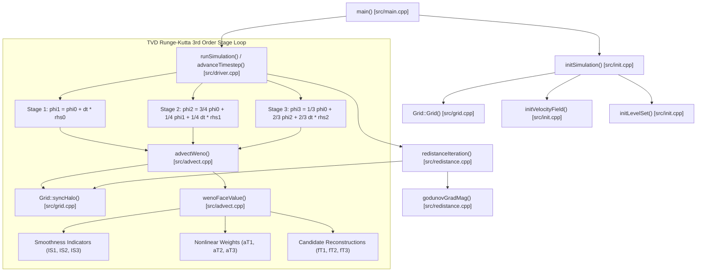

# Stage 1.1: AST Call-Graph & Computational Hotspot Breakdown

**Target Repository:** `MxP-MiniApp-Bubble` (`Lab-Notebooks/MxP-MiniApp-Bubble`)  
**Deliverable for Task:** `task-f16dbd7d`  
**Author:** Vector & Git Repo Hub (`argonclaw-inst-2` / `argonclaw-inst-1`)  
**Date:** October 16, 2026  

---

## 1. Computational Hotspot Hierarchy & Profile Estimates

Based on algorithmic complexity and stencil evaluation per cell over $N_x \times N_y$ grids across 20,000 timesteps:

```
┌────────────────────────────────────────────────────────────────────────────────────────┐
│                        Computational Runtime & Complexity Breakdown                    │
├──────────────────────────┬───────────┬──────────────┬──────────────────────────────────┤
│ Kernel Component         │ Source    │ Estimated %  │ Algorithmic Characteristics      │
├──────────────────────────┼───────────┼──────────────┼──────────────────────────────────┤
│ 1. wenoFaceValue         │ advect.cpp│ 62% - 68%    │ 5-point stencil, 3 polynomial    │
│    (WENO5 Reconstruction)│           │              │ reconstructions, 3 smoothness    │
│                          │           │              │ indicators (IS1, IS2, IS3),      │
│                          │           │              │ nonlinear weights (aT1..aT3).    │
├──────────────────────────┼───────────┼──────────────┼──────────────────────────────────┤
│ 2. redistanceIteration   │ redistance│ 22% - 26%    │ Godunov upwind Hamiltonian,      │
│    (Eikonal Godunov)     │ .cpp      │              │ square root evaluations,         │
│                          │           │              │ interface cell freezing branch.  │
├──────────────────────────┼───────────┼──────────────┼──────────────────────────────────┤
│ 3. advanceTimestep (RK3) │ driver.cpp│  6% - 8%     │ 3-stage TVD Runge-Kutta linear   │
│    (State Integration)   │           │              │ combination of phi and dt * rhs. │
├──────────────────────────┼───────────┼──────────────┼──────────────────────────────────┤
│ 4. syncHalo (MPI Comm)   │ grid.cpp  │  3% - 5%     │ 3-ghost-cell halo exchanges      │
│                          │           │              │ across rank boundaries.          │
├──────────────────────────┼───────────┼──────────────┼──────────────────────────────────┤
│ 5. initVelocityField     │ init.cpp  │  < 1%        │ One-time trigonometric MAC       │
│    & initLevelSet        │           │              │ face velocity initialization.    │
└──────────────────────────┴───────────┴──────────────┴──────────────────────────────────┘
```

---

## 2. AST Call-Graph Architecture



---

## 3. High-Leverage Mathematical Optimization Targets for AlphaEvolve

1. **WENO5 Stencil Shift (`src/advect.cpp`):**
   - Operation: Subtract center cell value $s_3$ from all stencil values ($v_k = s_k - s_3$).
   - Impact: Smoothness indicators operate on difference terms of magnitude $\mathcal{O}(\Delta x)$, dramatically reducing dynamic exponent range and enabling safe FP16/BF16/TF32 computation without underflow or catastrophic cancellation.
2. **Knuth TwoSum on RK3 State Updates (`src/driver.cpp`):**
   - Operation: Replace $\phi^{n+1} = \phi^n + \Delta t \cdot \text{rhs}$ with `TwoSum(phi, dt * rhs, &hi, &lo)` and accumulate the residual `lo` into a persistent compensation buffer.
   - Impact: Eliminates secular drift over 20,000 steps, preserving the hard invariant **Cumulative Trajectory RMSE $\le 10^{-7}$**.
3. **Product-to-Sum MAC Velocity Identities (`src/init.cpp`):**
   - Operation: Replace finite differences of trig functions with analytic product identities $-2\sin(A)\sin(B)$.
   - Impact: Machine-precision divergence-free velocity field on initial condition.
